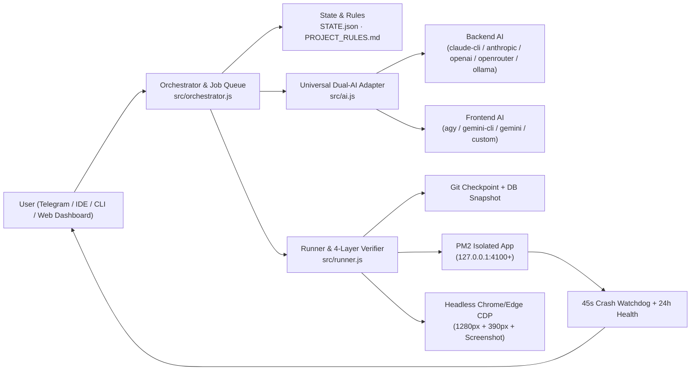
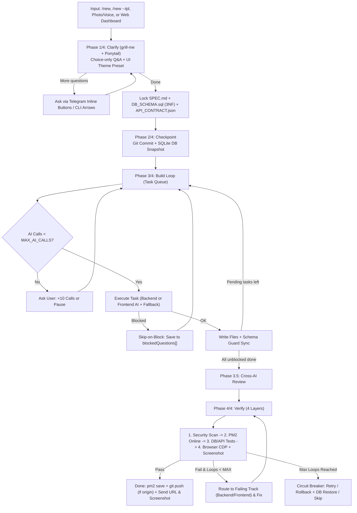

# DualLoop System Architecture & Full-Loop Flow

## 1. High-Level System Architecture

## 2. Full-Loop Execution Flow (4 Phases)

## 3. File Map

| File | Responsibility |
|------|----------------|
| `bin/cli.js` | `npx` arrow-key installer, `init`, `doctor`, `run`, `continue` |
| `src/config.js` | `.env` loader, provider normalization, `~/Desktop` resolution |
| `src/state.js` | `STATE.json`, metrics, `PROJECT_RULES.md`, compressed context |
| `src/ai.js` | 10-provider adapter, Auto-Fallback, 3NF DB rules, Cross-Review, Media |
| `src/runner.js` | Port check, Git/DB backup, 4-Layer Verify, CDP, Security, Zip/Proxy/Tunnel |
| `src/telegram.js` | 2-way Telegram bot, inline buttons, custom text, cancel, media/docs |
| `src/dashboard.js` | Built-in Web Control Server (`127.0.0.1:4099`) |
| `public/dashboard.html` | Real-time Web Control Panel UI |
| `skills/dualloop/SKILL.md` | Agent Skill for Antigravity, Claude Code, Codex, `.agents` |
